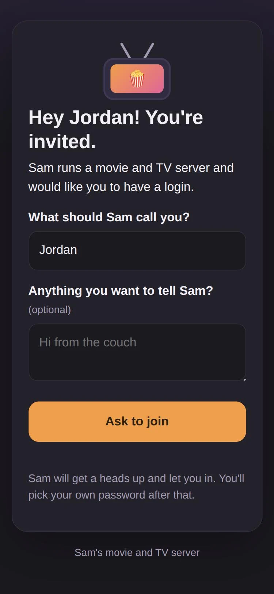

# Welcome (Jellyfin plugin)

Invite links for new users. You approve each one and they pick their own password, so no password ever goes through a chat message.

> Built with Claude for my own server and shared as is. Tested on Jellyfin 12.4. Issues and pull requests are welcome.



## Contents

- [How it works](#how-it-works)
- [Install](#install)
- [Settings](#settings)
- [New accounts](#new-accounts)
- [Security](#security)
- [Build and release](#build-and-release)

## How it works

1. **Dashboard -> Plugins -> Welcome -> Invite someone:** name it, copy the link, send it.
2. They open it and tap **Ask to join**.
3. You get a Discord ping (optional) and choose **Let them in** or **Decline**.
4. Their page updates by itself and they pick a username and password.
5. A setup page follows: which app to get, the server address, Quick Connect for TVs, and what's on the server.

**Optional:** new movies and episodes posted to a Discord channel, batched, never saying who requested them.

## Install

Needs Jellyfin 12.2 or newer.

**From the catalog (gets update notices)**

1. Dashboard -> Plugins -> **Repositories** -> add `https://raw.githubusercontent.com/coltonfretz/jellyfin-welcome/main/manifest.json` (name it `Welcome`).
2. Dashboard -> Plugins -> **Catalog** -> Welcome -> Install.
3. Restart Jellyfin.

**By hand:** unzip `Jellyfin.Plugin.Welcome.dll` from [Releases](https://github.com/coltonfretz/jellyfin-welcome/releases) into `<plugins>/Welcome_<version>/` (`/config/plugins` in the Docker image) and restart.

The join page is `/Welcome/join/<code>` on your server, so it must be reachable wherever your invitees are (usually your public Jellyfin address).

## Settings

Dashboard -> Plugins -> Welcome, below the invite list. Every setting has a working default.

**Links and alerts**

| Setting | What it does |
|---|---|
| Public address | e.g. `https://jellyfin.example.com`, used in invite links, the setup page and Discord. Empty: the address the page was opened at. |
| Discord webhook | "Someone wants in" pings. Use a private channel. Never shown back on the page. |
| Invite links last | Days an unused link stays valid (1 to 60, default 7). |
| Shortest password | Minimum password length (default 8). |

**What the pages say**

| Setting | What it does |
|---|---|
| Your name / Server name | "Waiting for Sam", "You're invited to (server)". |
| Intro | The join page's first paragraph. |
| What's inside | Tiles on the setup page, `Title=description`, one per line. |
| Note | A line under the tiles. |
| Music app | Name, address and a short description of a web music player on the same accounts (e.g. [Fretzpod](https://github.com/coltonfretz/fretzpod)). Adds a "Music on your phone" step. |
| TV app | Name, setup page and which TVs (default "Fire TV or Android TV") for your own TV app. Those TVs get its setup page; others get the stock Jellyfin apps. |

**Accounts and new arrivals**

| Setting | What it does |
|---|---|
| Copy permissions from | A non-admin template account. Empty: the built-in permissions below. |
| New arrivals webhook + libraries | Where new-arrival posts go and which libraries to announce. |

## New accounts

- **Built-in permissions** (no template): every library, Live TV, downloads, SyncPlay, casting. Nothing to manage or delete, no control of others' sessions, hidden from the login screen's user list.
- Want less? Make one account the way you like and pick it as the template. Admin accounts are never used as a template.
- New accounts copy the template's (or first admin's) **library order** and **hidden-from-My-Media** libraries. If that fails, sign-up still finishes.

## Security

- **Codes:** 128-bit random, single-use, expiring, compared in constant time. Wrong guesses are throttled; at most 10 requests wait at once.
- **Claiming:** asking hands that browser a 256-bit token (only its hash is stored), so a forwarded link can't claim an approved account. The token travels in a request header, never in a URL, so it stays out of access logs.
- **Approvals run out:** an approved invite has 7 days to be finished, then it shows as expired.
- **Accounts:** none exists until you approve. One finish at a time; a failed setup deletes the half-made account (and logs a critical error if even that fails, so it can be removed by hand).
- **Visitor text** is escaped everywhere. Discord posts can't @mention anyone and links aren't clickable.
- **The join page** sends no Referer, can't be framed, is never cached, and has a strict Content-Security-Policy. A reverse proxy that sets its own CSP header for Jellyfin should leave `/Welcome` alone, or it replaces this one.
- **Endpoints:** admin ones need an administrator. Public ones are the join page, the invite steps (valid code required) and the page wording.
- **Data:** invites live in `invites.json` in the plugin data folder and are deleted 30 days after they end.

## Build and release

```bash
./build.sh
```

Builds `dist/Jellyfin.Plugin.Welcome.dll` in the .NET 10 SDK container (Docker only). `BUILD_HOST=user@host ./build.sh` builds over SSH.

To release: bump `<AssemblyVersion>` in the `.csproj`, commit, then `./release.sh "what changed"`.

## License

MIT, see [LICENSE](LICENSE).
