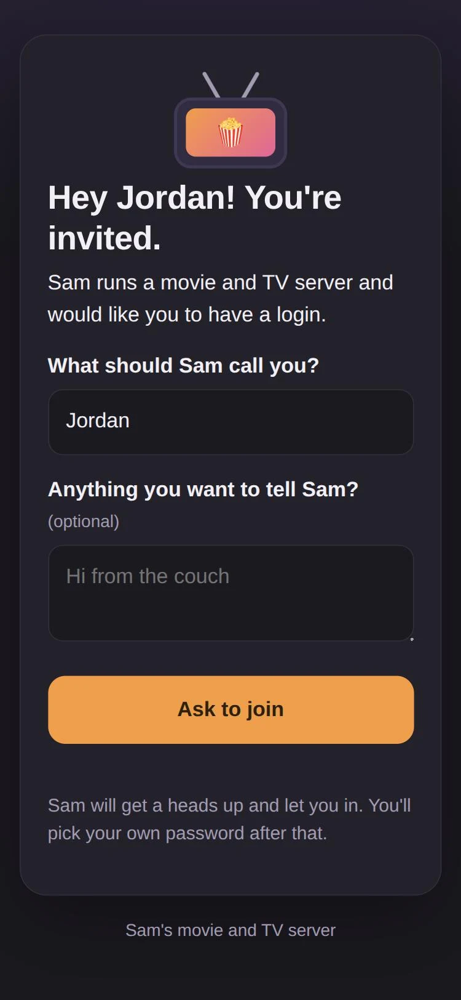

# Welcome (Jellyfin plugin)

Invite links for new users, with you approving each one, so nobody's password ever travels through a chat message.

> Built with Claude for my own server and shared as is. It works on my setup (Jellyfin 12.4). Updated as needed. Issues and pull requests are welcome.



## How it works

1. **Dashboard > Plugins > Welcome > Invite someone:** type who it's for, copy the link, send it.
2. They open it on their phone, type their name, and tap **Ask to join**.
3. You get a Discord ping (optional) with a link back to the Welcome page. **Let them in** or **Decline**.
4. Their page flips to "You're in!" by itself, and they pick their own username and password.
5. They get a short setup page: which app to get, the server address with a copy button, Quick Connect for TVs, and what's on the server.

Optional extra: **new arrivals.** New movies and episodes are posted to a Discord channel your users can see, batched (a season pack is one post), and without ever saying who requested anything.

## Install

Needs Jellyfin 12.2 or newer.

**From the plugin catalog (gets update notices):**

1. Dashboard > Plugins > **Repositories** (on some versions, the gear icon on the Catalog page) > add:
   - Name: `Welcome`
   - URL: `https://raw.githubusercontent.com/coltonfretz/jellyfin-welcome/main/manifest.json`
2. Dashboard > Plugins > **Catalog** > Welcome > Install.
3. Restart Jellyfin.

**By hand:** download `welcome_<version>.zip` from [Releases](https://github.com/coltonfretz/jellyfin-welcome/releases), put `Jellyfin.Plugin.Welcome.dll` in a folder named `Welcome_<version>` inside Jellyfin's plugins folder (`/config/plugins` in the official Docker image), and restart Jellyfin.

The join page lives at `/Welcome/join/<code>` on your server, so it has to be reachable from wherever the people you invite are. That's usually the same address they'll use for Jellyfin.

## Settings

Dashboard > Plugins > Welcome, under the invite list.

| Setting | What it does |
|---|---|
| Public address | The address people use from outside, for example `https://jellyfin.example.com`. Invite links, the setup page and Discord links use it. Empty: links use the address the page was opened at, and Discord posts go out without links. |
| Discord webhook | "Someone wants in" pings. Use a private channel. The value stays on the server; the page only shows whether one is saved. |
| Invite links last | Days an unused link stays valid (1 to 60, default 7). |
| New accounts copy their permissions from | A non-admin account whose permissions and library order new accounts get. Default: built-in permissions (below). An administrator is never used, even if picked by mistake. |
| Your name / Server name | What the join page calls you ("Waiting for Sam", "Ask Sam") and the server ("New on ..." posts). |
| Intro, What's inside, Note | The join page's first paragraph, the tiles on the finished page (`Title=description`, one per line), and a note under them. |
| Music app | Optional name, address and a few words about a web music player on the same accounts (for example [Fretzpod](https://github.com/coltonfretz/fretzpod)). It adds a "Music on your phone" step. |
| New arrivals webhook and libraries | Where new-arrival posts go, and which movie and TV libraries to announce from. |
| Shortest password | Minimum length for the password people pick (default 8). |

Every setting has a plain default, so an empty install works.

**Built-in permissions** (when no template account is picked): every library, Live TV, downloads, SyncPlay, casting to shared devices; nothing to manage or delete, no controlling other people's sessions, hidden from the login screen's user list. If that's more than you want new people to have, make one account the way you want and pick it as the template.

New accounts also get the template's (or the first admin's) **library order**, so the top bar and My Media row read the way you set them up instead of alphabetically. If that step fails, sign-up still finishes with the default order.

## Security

- Invite codes are 128-bit random, single-use, and expire. They're compared in constant time.
- Asking to join hands that browser a 256-bit token (only its hash is stored). Only the browser that asked can finish, so a forwarded link can't claim an approved account.
- No account exists until you approve. Finishing is one at a time, so a double tap can't make two accounts, and a failed setup deletes the half-made account.
- Wrong codes are throttled, and at most 10 requests can wait at once.
- Names and notes typed by visitors are escaped everywhere (Discord ping, admin page). Discord posts can't @mention anyone and typed links don't become clickable.
- The join page sends no Referer (the code is in its address), can't be framed, and is never cached.
- Admin endpoints need a Jellyfin administrator. The only public endpoints are the join page, the invite steps (each needs a valid code), and the join page's wording.
- Invites live in `invites.json` in the plugin's data folder. Ones that are over (account made, declined, or expired unused) are deleted 30 days after they end; the Jellyfin account is the lasting record.

## Build

```bash
./build.sh
```

Builds `dist/Jellyfin.Plugin.Welcome.dll` in the official .NET 10 SDK container, so Docker is all you need. `BUILD_HOST=user@host ./build.sh` builds on another machine over SSH.

For a new version, bump `<AssemblyVersion>` in the `.csproj`, commit, then `./release.sh "what changed"` builds it, makes the GitHub Release, and adds it to `manifest.json`.

## License

MIT. See [LICENSE](LICENSE).
